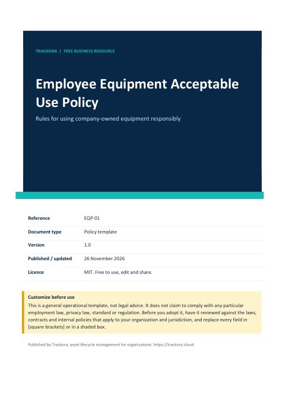
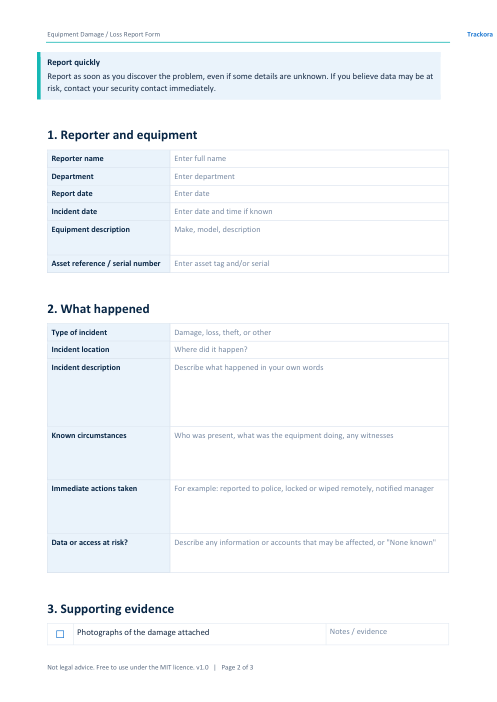
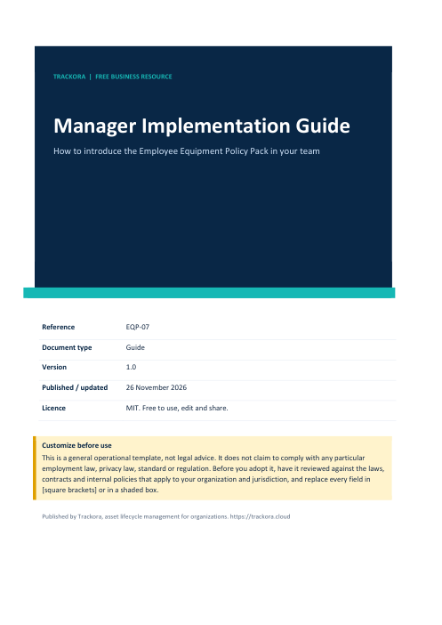

# Employee Equipment Policy Pack

Seven editable documents for managing employee responsibilities when company equipment is issued, used, damaged or returned.

Part of the [Trackora free resource library](../README.md). Free to download. No sign-up, email or account needed.

## Downloads

| Document | Purpose | Editable | Print / read |
|---|---|---|---|
| Employee Equipment Acceptable Use Policy | Rules for using, protecting and returning company equipment. | [DOCX](documents/Employee-Equipment-Acceptable-Use-Policy.docx) | [PDF](pdf/Employee-Equipment-Acceptable-Use-Policy.pdf) |
| Employee Equipment Agreement | Records what was issued and what each side acknowledges. | [DOCX](documents/Employee-Equipment-Agreement.docx) | [PDF](pdf/Employee-Equipment-Agreement.pdf) |
| Equipment Issue Acknowledgment Form | A short record that equipment was issued and received. | [DOCX](documents/Equipment-Issue-Acknowledgment-Form.docx) | [PDF](pdf/Equipment-Issue-Acknowledgment-Form.pdf) |
| Equipment Damage / Loss Report Form | Facts, evidence and follow-up for damaged, lost or stolen equipment. | [DOCX](documents/Equipment-Damage-Loss-Report-Form.docx) | [PDF](pdf/Equipment-Damage-Loss-Report-Form.pdf) |
| Equipment Return Confirmation Form | Confirms what was returned, its condition and anything outstanding. | [DOCX](documents/Equipment-Return-Confirmation-Form.docx) | [PDF](pdf/Equipment-Return-Confirmation-Form.pdf) |
| Remote Working Equipment Policy | Responsibilities for equipment used at home or while travelling. | [DOCX](documents/Remote-Working-Equipment-Policy.docx) | [PDF](pdf/Remote-Working-Equipment-Policy.pdf) |
| Manager Implementation Guide | Rollout plan, process and common mistakes for managers. | [DOCX](documents/Manager-Implementation-Guide.docx) | [PDF](pdf/Manager-Implementation-Guide.pdf) |

Version 1.0, updated 26 November 2026.

## Preview

## How to use it

1. Read the Manager Implementation Guide first.
2. Fill in the shaded form fields in the policies. The forms use fillable fields (Word content controls): click a field and type.
3. Add your organization name, logo, dates, approval roles and any provisions required where you operate.
4. Have your legal or HR team review everything before you adopt it.

## Important: not legal advice

These are general operational templates, not legal advice. They do not claim to comply with any employment law, privacy law, standard or regulation, and they contain no legal citations. Requirements differ by organization and jurisdiction. Review the documents against the laws, contracts and policies that apply to you.

## Licence

Original documents in this folder are released under the [MIT licence](../../LICENSE): free to use, edit, share and adapt, including commercially, with the copyright notice kept. The documents are set in Calibri, a Microsoft typeface not covered by this licence; you can change it freely. All example content is fictional.

---
Establish clear equipment responsibilities. Track equipment assignments and returns with [Trackora](https://trackora.cloud/?utm_source=github&utm_medium=repo&utm_campaign=free-resource-library&utm_content=policy-pack).
