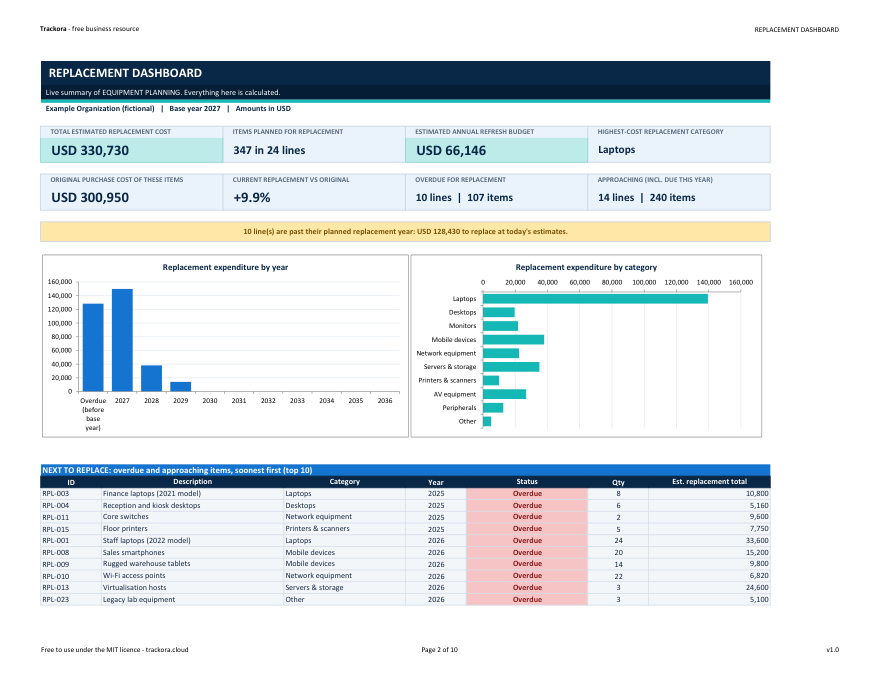
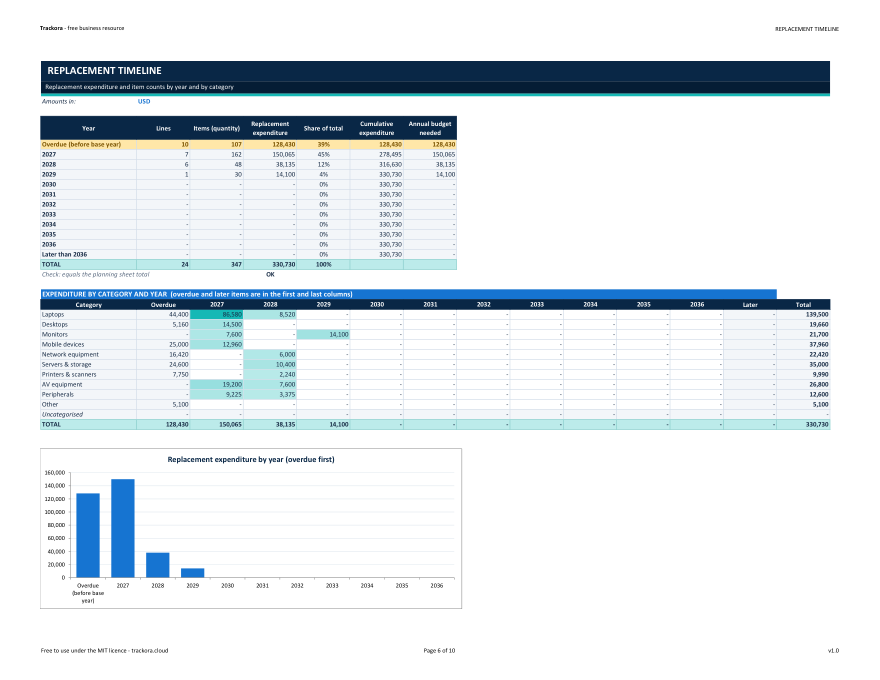

# Equipment Replacement Cost Calculator

Estimate replacement costs, see when equipment is due and plan annual refresh budgets.

Part of the [Trackora free resource library](../README.md). Free to download. No sign-up, email or account needed.

## Downloads

| File | Type | Link |
|---|---|---|
| Equipment-Replacement-Cost-Calculator.xlsx | Workbook | [Download](workbook/Equipment-Replacement-Cost-Calculator.xlsx) |
| Equipment-Replacement-Cost-Calculator-User-Guide.docx | User guide | [Download](guide/Equipment-Replacement-Cost-Calculator-User-Guide.docx) |
| Equipment-Replacement-Cost-Calculator-User-Guide.pdf | User guide | [Download](guide/Equipment-Replacement-Cost-Calculator-User-Guide.pdf) |

Version 1.0, updated 26 November 2026.

## What is inside

- REPLACEMENT DASHBOARD: total replacement cost, annual refresh budget, overdue and approaching items, and a next-10 list
- EQUIPMENT PLANNING: 200 ready rows with original and current replacement cost, useful life, planned replacement year, condition and priority
- REPLACEMENT TIMELINE: spend and item counts by year and by category
- SCENARIO ANALYSIS: change prices, useful life, timing and quantities and see future budgets
- ASSUMPTIONS & HELP: methodology, and clear labels that all figures are estimates

## Who it is for

IT managers, operations managers and finance partners preparing a multi-year equipment refresh budget.

## How to use it

1. Open the workbook and read the START HERE sheet.
2. Delete the fictional example rows and enter your own data in the blue cells. Grey cells calculate themselves; do not edit them.
3. Read the dashboard. Warnings appear in amber and red.
4. The user guide explains each sheet and every calculation.

## Preview

## Important

Estimates only. It is not an accounting depreciation calculation, and useful life is a planning assumption, not a manufacturer recommendation. Example data is fictional.

## Excel and Google Sheets

Built in Excel format (.xlsx) without macros. Formulas, drop-down lists, conditional formatting and charts carry over when you upload the file to Google Drive and open it with Google Sheets. Sheet protection and some chart styling do not carry over. Excel 2016 or later gives the best result.

## Licence

Original templates, workbooks and documents in this folder are released under the [MIT licence](../../LICENSE): free to use, edit, share and adapt, including commercially, with the copyright notice kept. The documents are set in the Calibri typeface, which belongs to Microsoft and is not covered by this licence; Calibri is used only as the display font, and you can change it freely. All example names, suppliers, prices and people are fictional.

---
Plan future equipment replacements. Keep your current equipment records organized with [Trackora](https://trackora.cloud/?utm_source=github&utm_medium=repo&utm_campaign=free-resource-library&utm_content=replacement-calculator).
