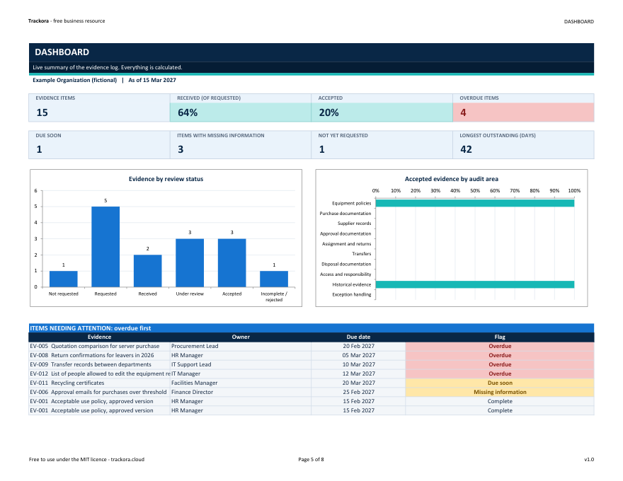
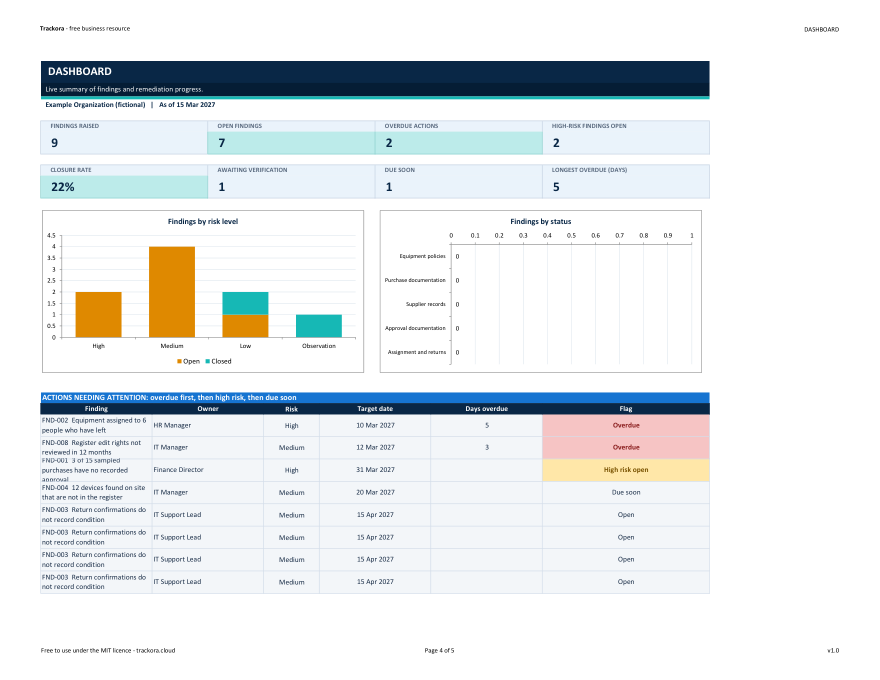
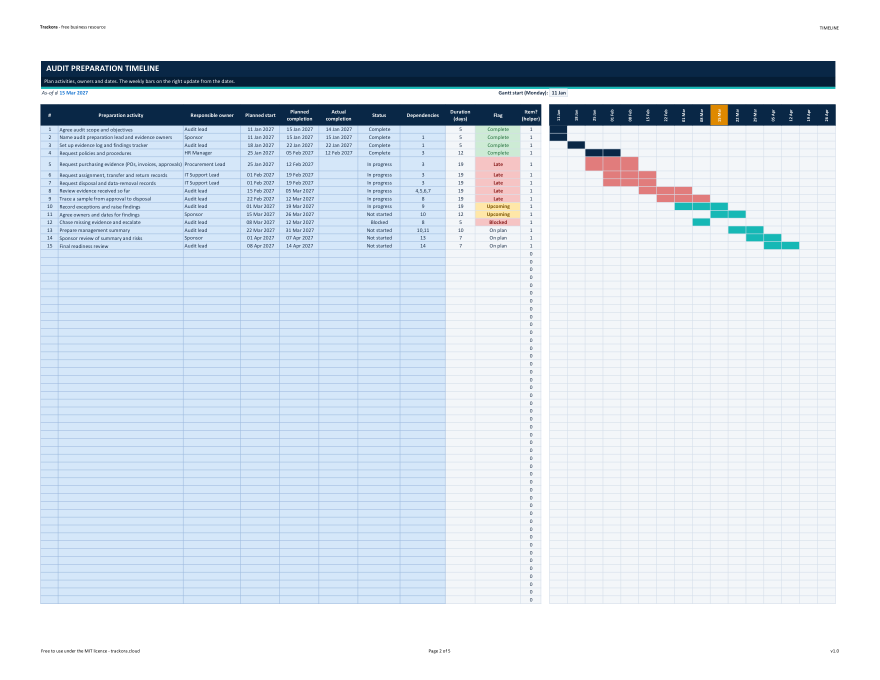

# IT Asset Audit Preparation Pack

Seven resources that help you prepare for an internal equipment or IT asset audit by organizing evidence, responsibilities and documentation.

Part of the [Trackora free resource library](../README.md). Free to download. No sign-up, email or account needed.

## Downloads

| Resource | Purpose | Editable | Print / read |
|---|---|---|---|
| IT Asset Audit Preparation Guide | Objectives, scope, roles, evidence, exceptions, findings and reporting. | [DOCX](documents/IT-Asset-Audit-Preparation-Guide.docx) | [PDF](pdf/IT-Asset-Audit-Preparation-Guide.pdf) |
| Audit Readiness Checklist | Ten control areas to check before the audit. | [DOCX](documents/Audit-Readiness-Checklist.docx) | [PDF](pdf/Audit-Readiness-Checklist.pdf) |
| Document Request Checklist | Documents auditors typically ask for, and who provides them. | [DOCX](documents/Document-Request-Checklist.docx) | [PDF](pdf/Document-Request-Checklist.pdf) |
| Management Summary Template | Scope, status, findings, risks and decisions for management. | [DOCX](documents/Management-Summary-Template.docx) | [PDF](pdf/Management-Summary-Template.pdf) |
| Audit Evidence Log | Track every evidence item from request to acceptance. | [XLSX](workbook/Audit-Evidence-Log.xlsx) | n/a |
| Findings and Remediation Tracker | Findings, risk, owners, target dates and verification. | [XLSX](workbook/Audit-Findings-and-Remediation-Tracker.xlsx) | n/a |
| Audit Preparation Timeline | Activities, owners and dates, with a weekly bar chart and dashboard. | [XLSX](workbook/Audit-Preparation-Timeline.xlsx) | n/a |

Version 1.0, updated 26 November 2026.

## Preview

## How to use it

1. Read the Preparation Guide and agree scope, objectives and roles.
2. List evidence with the Document Request Checklist, then track it in the Evidence Log.
3. Plan the work in the Timeline. Check each area with the Readiness Checklist.
4. Record exceptions in the Findings Tracker and report with the Management Summary.

## Important

This pack is an audit-preparation and evidence-management aid. It is not an asset register or stocktake tool. Completing it does not guarantee compliance, certification or audit success, and requirements vary by organization, jurisdiction and audit scope. It is not legal, accounting or audit advice. Example data is fictional.

## Excel and Google Sheets

Built in Excel format (.xlsx) without macros. Formulas, drop-down lists, conditional formatting and charts carry over when you upload the file to Google Drive and open it with Google Sheets. Sheet protection and some chart styling do not carry over. Excel 2016 or later gives the best result.

## Licence

Original templates, workbooks and documents in this folder are released under the [MIT licence](../../LICENSE): free to use, edit, share and adapt, including commercially, with the copyright notice kept. The documents are set in the Calibri typeface, which belongs to Microsoft and is not covered by this licence; Calibri is used only as the display font, and you can change it freely. All example names, suppliers, prices and people are fictional.

---
Prepare your audit documentation. Maintain equipment records and activity history with [Trackora](https://trackora.cloud/?utm_source=github&utm_medium=repo&utm_campaign=free-resource-library&utm_content=audit-pack).
