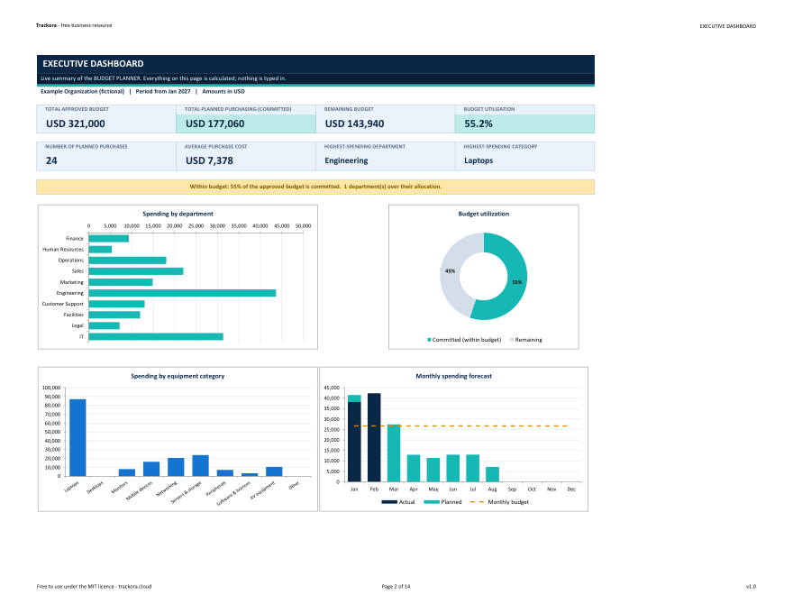
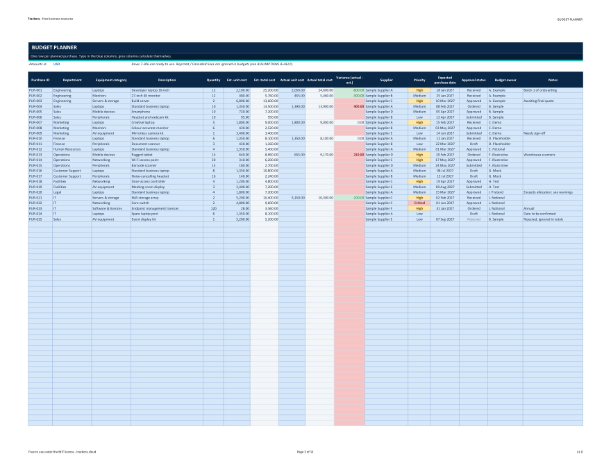
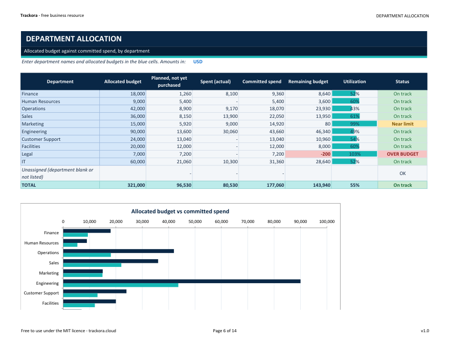

# IT Equipment Budget Planner

Plan equipment purchasing budgets, allocate them across departments and forecast spending.

Part of the [Trackora free resource library](../README.md). Free to download. No sign-up, email or account needed.

## Downloads

| File | Type | Link |
|---|---|---|
| IT-Equipment-Budget-Planner.xlsx | Workbook | [Download](workbook/IT-Equipment-Budget-Planner.xlsx) |
| IT-Equipment-Budget-Planner-User-Guide.docx | User guide | [Download](guide/IT-Equipment-Budget-Planner-User-Guide.docx) |
| IT-Equipment-Budget-Planner-User-Guide.pdf | User guide | [Download](guide/IT-Equipment-Budget-Planner-User-Guide.pdf) |

Version 1.0, updated 26 November 2026.

## What is inside

- EXECUTIVE DASHBOARD: committed spend, remaining budget, utilization, highest-spending department and category, with four charts
- BUDGET PLANNER: 200 ready rows with estimated and actual costs, variance, priority, approval status and validation
- DEPARTMENT ALLOCATION: allocated, planned, actual and remaining budget per department
- MONTHLY FORECAST: planned and actual purchasing by month against a monthly budget
- SCENARIO PLANNER: +5%, +10%, +15% and custom price scenarios, plus quantity and budget changes
- ASSUMPTIONS & HELP: every calculation explained

## Who it is for

IT managers, operations managers, finance partners and department heads agreeing an equipment budget.

## How to use it

1. Open the workbook and read the START HERE sheet.
2. Delete the fictional example rows and enter your own data in the blue cells. Grey cells calculate themselves; do not edit them.
3. Read the dashboard. Warnings appear in amber and red.
4. The user guide explains each sheet and every calculation.

## Preview

## Important

It is a planning workbook, not an asset register. It does not predict market prices or fetch supplier quotations. Example data is fictional.

## Excel and Google Sheets

Built in Excel format (.xlsx) without macros. Formulas, drop-down lists, conditional formatting and charts carry over when you upload the file to Google Drive and open it with Google Sheets. Sheet protection and some chart styling do not carry over. Excel 2016 or later gives the best result.

## Licence

Original templates, workbooks and documents in this folder are released under the [MIT licence](../../LICENSE): free to use, edit, share and adapt, including commercially, with the copyright notice kept. The documents are set in the Calibri typeface, which belongs to Microsoft and is not covered by this licence; Calibri is used only as the display font, and you can change it freely. All example names, suppliers, prices and people are fictional.

---
Plan your equipment spending. Manage the equipment you already own with [Trackora](https://trackora.cloud/?utm_source=github&utm_medium=repo&utm_campaign=free-resource-library&utm_content=budget-planner).
