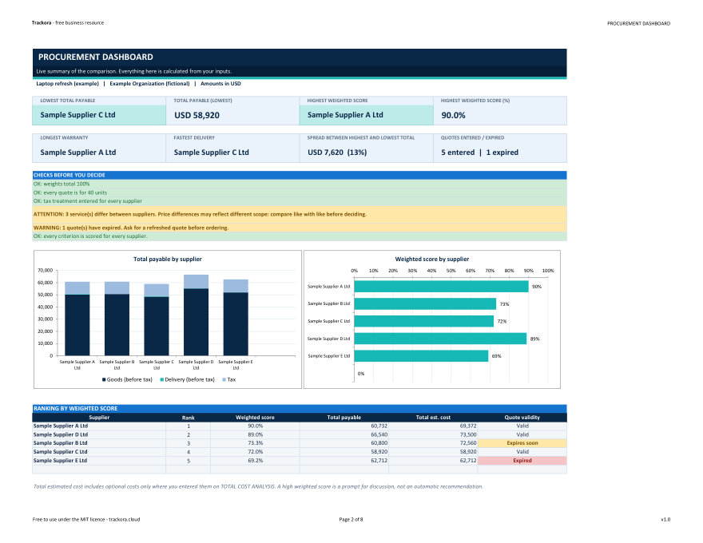
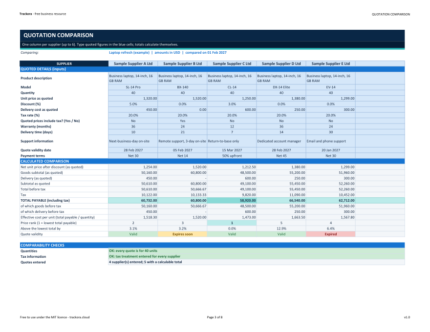
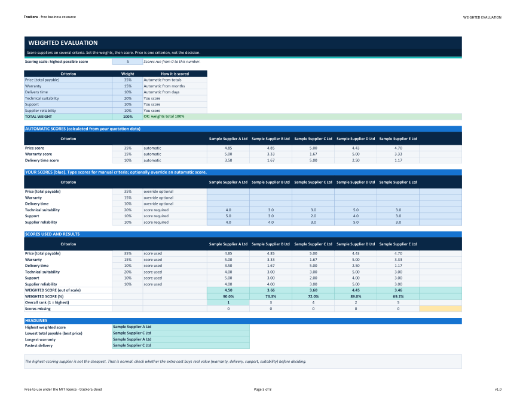

# IT Procurement Comparison Toolkit

Compare supplier quotations on total cost and weighted criteria, and record the decision.

Part of the [Trackora free resource library](../README.md). Free to download. No sign-up, email or account needed.

## Downloads

| File | Type | Link |
|---|---|---|
| IT-Procurement-Comparison-Toolkit.xlsx | Workbook | [Download](workbook/IT-Procurement-Comparison-Toolkit.xlsx) |
| IT-Procurement-Comparison-Toolkit-User-Guide.docx | User guide | [Download](guide/IT-Procurement-Comparison-Toolkit-User-Guide.docx) |
| IT-Procurement-Comparison-Toolkit-User-Guide.pdf | User guide | [Download](guide/IT-Procurement-Comparison-Toolkit-User-Guide.pdf) |

Version 1.0, updated 26 November 2026.

## What is inside

- QUOTATION COMPARISON: six suppliers side by side, with discounts, delivery, tax (included or excluded), warranty, delivery time and quote validity
- TOTAL COST ANALYSIS: initial acquisition cost kept separate from optional installation and multi-year support, plus a table of what each supplier includes
- WEIGHTED EVALUATION: configurable weights (with a warning if they do not total 100%) and scoring scale; automatic price, warranty and delivery scores
- SUPPLIER REVIEW: advantages, risks, open questions and a decision and approval record
- PROCUREMENT DASHBOARD: lowest total, highest score, ranking and warnings

## Who it is for

Procurement professionals, IT and operations managers and finance reviewers who need to explain why a supplier was chosen.

## How to use it

1. Open the workbook and read the START HERE sheet.
2. Delete the fictional example rows and enter your own data in the blue cells. Grey cells calculate themselves; do not edit them.
3. Read the dashboard. Warnings appear in amber and red.
4. The user guide explains each sheet and every calculation.

## Preview

## Important

It supports a decision; it does not make one. It does not fetch prices or contact suppliers, and the highest score is not an automatic recommendation. Example data is fictional.

## Excel and Google Sheets

Built in Excel format (.xlsx) without macros. Formulas, drop-down lists, conditional formatting and charts carry over when you upload the file to Google Drive and open it with Google Sheets. Sheet protection and some chart styling do not carry over. Excel 2016 or later gives the best result.

## Licence

Original templates, workbooks and documents in this folder are released under the [MIT licence](../../LICENSE): free to use, edit, share and adapt, including commercially, with the copyright notice kept. The documents are set in the Calibri typeface, which belongs to Microsoft and is not covered by this licence; Calibri is used only as the display font, and you can change it freely. All example names, suppliers, prices and people are fictional.

---
Compare purchasing options. Keep track of the equipment your organization acquires with [Trackora](https://trackora.cloud/?utm_source=github&utm_medium=repo&utm_campaign=free-resource-library&utm_content=procurement-toolkit).
